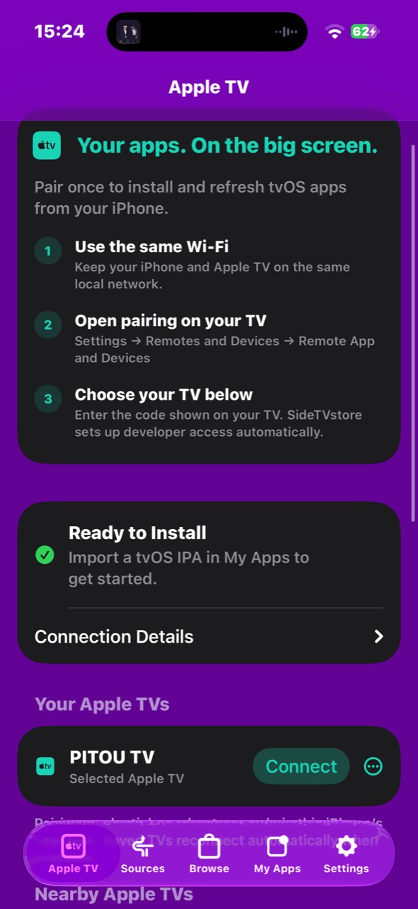
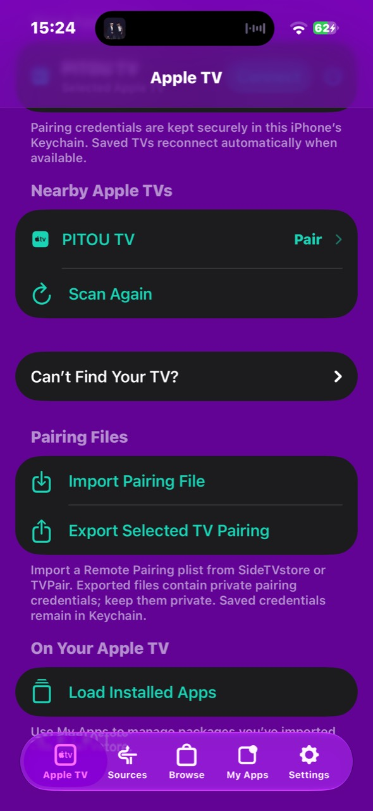
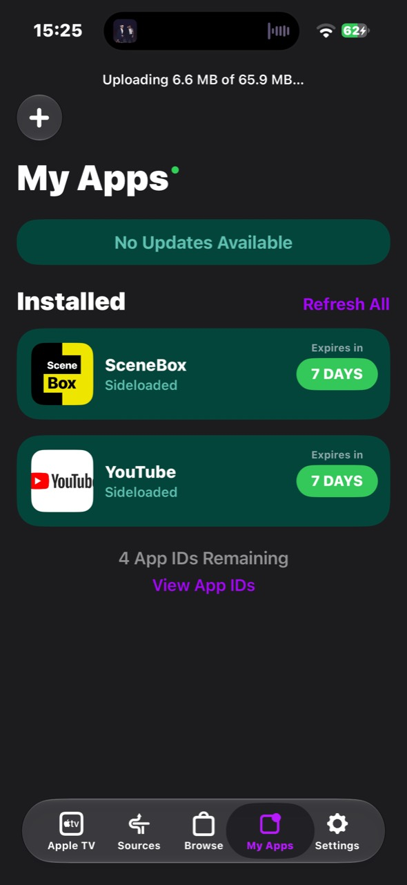

# SideTVstore

Your apps. On the big screen.

I made SideTVstore so I can install and manage tvOS apps on my Apple TV directly from my iPhone over local Wi-Fi. It's my Apple TV port of [SideStore](https://github.com/SideStore/SideStore), using the discovery and pairing work from my [TVPair project](https://github.com/hubzzzgr/tvOS-pairtest).

I kept SideStore's Apple ID sign-in, signing, IPA management, and familiar interface, and replaced the iPhone pairing/VPN connection with a direct connection to a paired Apple TV. Once the controller is installed, I can manage my TV apps from my iPhone without a computer or LocalDevVPN.

**[Download the IPA](https://github.com/hubzzzgr/SideStore-tvOS/releases/download/v0.7.0-tvos.0702/SideTVstore-unsigned.ipa)** · [Release notes](https://github.com/hubzzzgr/SideStore-tvOS/releases) · [Detailed setup and platform limits](docs/APPLE-TV.md)

## Tested setup

tested this on a physical iPhone running **iOS 27.0**, installing apps on a physical Apple TV running **tvOS 27.2**. **It also works perfectly inside LiveContainer in my setup.** The screenshots below are from my testing.

These results describe my setup, rather than every iPhone, Apple TV, firmware version, or LiveContainer configuration. The iPhone app targets iOS 17 and later; other combinations still need testing.

## Screenshots

<p align="center">
  
  
  
</p>

## Features

- **Pair over Wi-Fi:** find nearby Apple TVs, enter the code shown on the TV, and save the pairing for automatic reconnection. I can also enter an IP address if discovery doesn't find my TV.
- **Set up developer access automatically:** setup runs the TVPair developer-trust procedure and checks that the necessary services actually respond before allowing installation.
- **Install and manage tvOS IPAs:** import an IPA, sign it with my Apple ID or an imported signing certificate, and install, update, refresh, or uninstall it on the selected TV.
- **Keep track of my apps:** My Apps shows artwork, signing expiry, refresh controls.
- **Import and export pairing files:** back up or restore a saved Remote Pairing plist through Files. Saved credentials stay in the iPhone's Keychain; exported files contain private credentials and need to be kept private.
- **Upload status:** Show upload status with byte count.
- **Use LiveContainer:** Works perfectly inside livecontainer

## Getting started

1. Download `SideTVstore-unsigned.ipa` from [Releases](https://github.com/hubzzzgr/SideStore-tvOS/releases). Sign and install it using your preferred iPhone installation method, or import it into your configured LiveContainer setup. The download is an **iPhone controller**, not a tvOS app; an unsigned IPA cannot be installed directly by iOS.
2. Put the iPhone and Apple TV on the same local Wi-Fi network and allow Local Network access.
3. On Apple TV, open **Settings → Remotes and Devices → Remote App and Devices**.
4. In SideTVstore's **Apple TV** tab, choose your TV and enter its on-screen code. Wait for **Ready to Install**.
5. Sign in with your Apple ID in Settings, or configure your signing certificate. In **My Apps**, tap **+** and choose a decrypted, device-compatible **tvOS IPA**.


## Building

The [GitHub Actions workflow](https://github.com/hubzzzgr/SideStore-tvOS/actions/workflows/tvos-iphone.yml) produces an unsigned arm64 IPA for physical iPhones on a macOS runner. CI does not need paid Apple Developer credentials. That does not change the signing requirements when using the app.

To build locally on macOS with Xcode 26.3 or newer:

```sh
git submodule update --init --recursive
xcodebuild -project AltStore.xcodeproj -scheme SideStore -configuration Release \
  -destination 'generic/platform=iOS' -sdk iphoneos ARCHS=arm64 \
  CODE_SIGNING_ALLOWED=NO CODE_SIGNING_REQUIRED=NO archive
```

## Credits and source

This project builds on [SideStore](https://github.com/SideStore/SideStore), originally forked from [AltStore](https://github.com/altstoreio/AltStore), and my [TVPair pairing POC](https://github.com/hubzzzgr/tvOS-pairtest). The original authorship, AGPL-3.0 license, and third-party notices remain intact. This fork has been developed with AI assistance.

Development is on the [`tvos` branch](https://github.com/hubzzzgr/SideStore-tvOS/tree/tvos).
